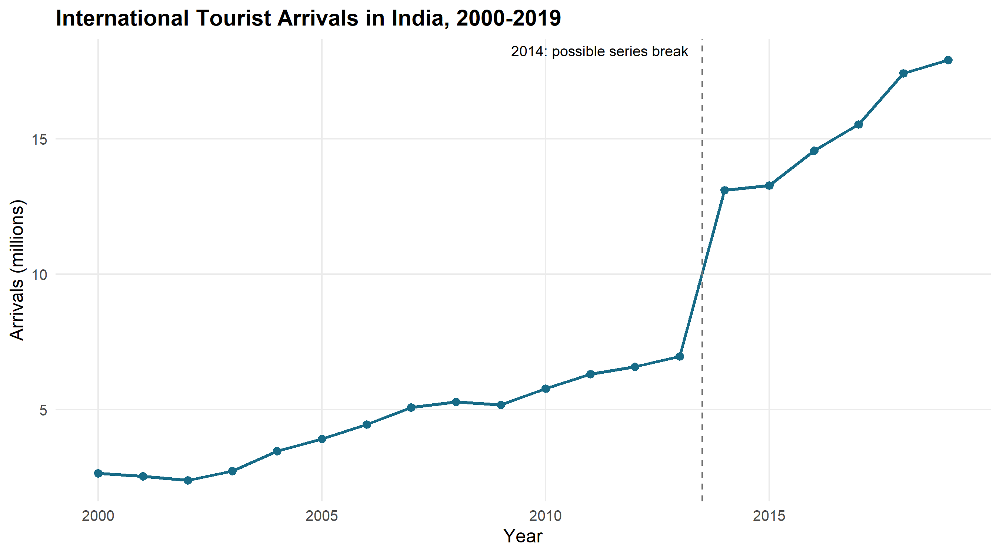
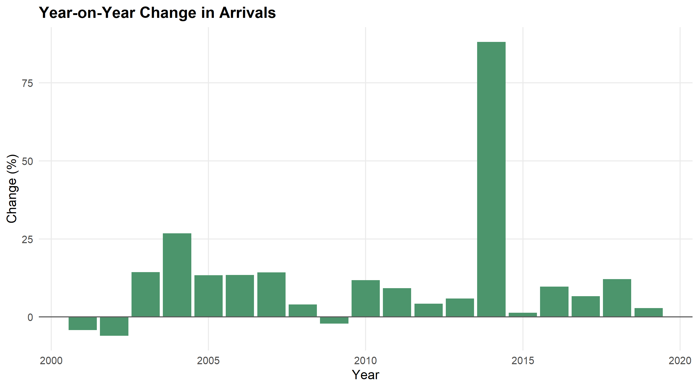
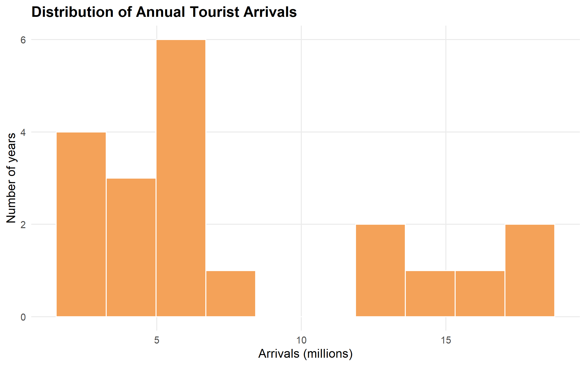
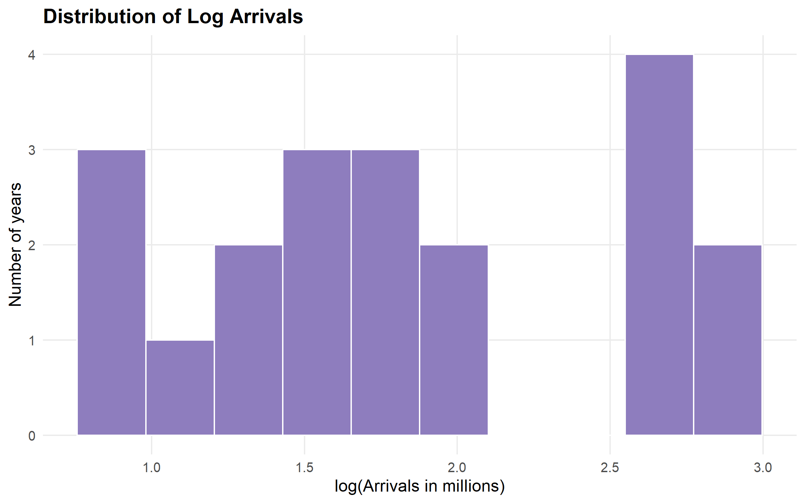
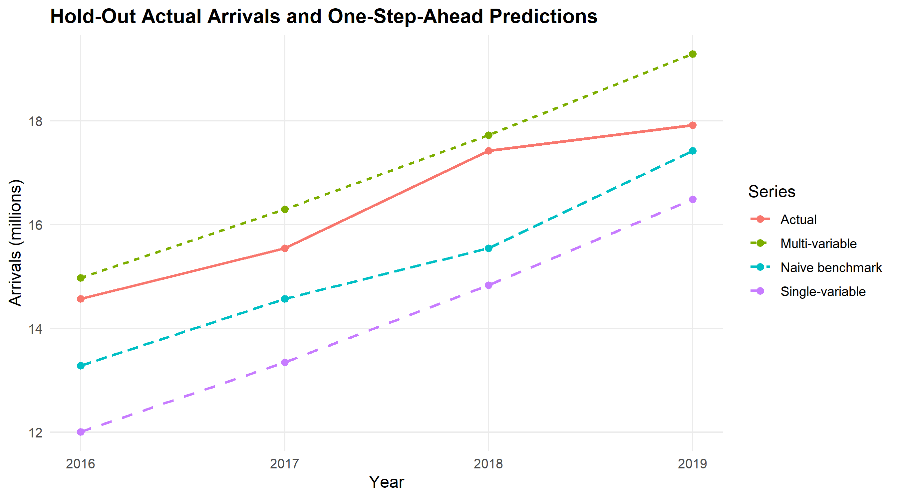
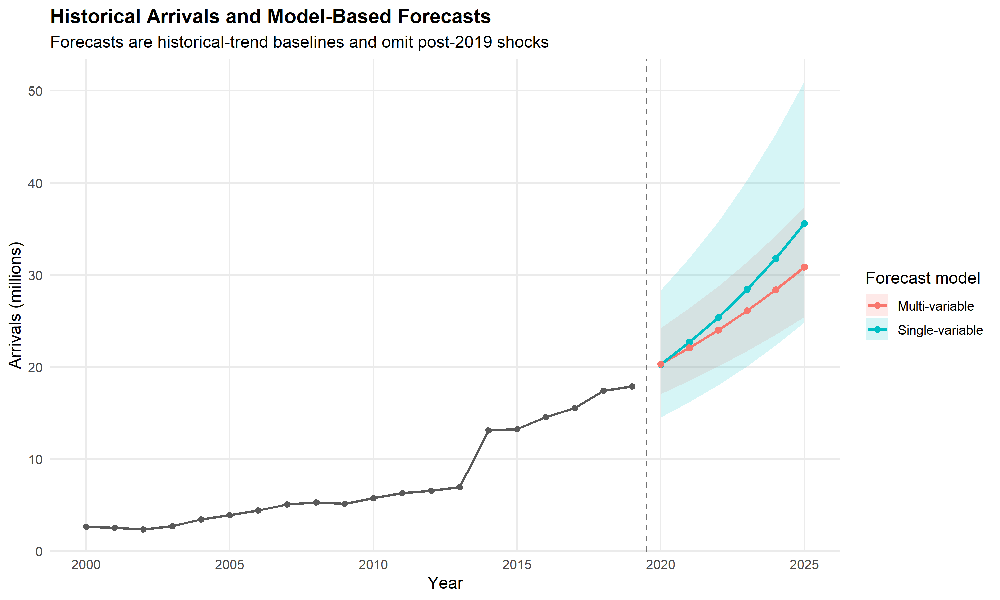

# Case Study 7: Tourism Demand Forecasting

**Subject:** Data Science Using R  
**Dataset:** World Bank World Development Indicators (WDI), International tourism, number of arrivals (`ST.INT.ARVL`)  
**Country:** India (`IND`)  
**Period analyzed:** 2000–2019  
**Language and visualization:** R and ggplot2

This report follows the required 13-section case-study format. Each section contains the **Theory**, the **R Code** used (or the relevant executable code excerpt from [analysis.R](./analysis.R)), and the **Actual Output** from the successful run. All numerical results below are from the downloaded CSV files and generated files in `outputs/`; no observations or model results have been fabricated.

---

## 1. Introduction

### Theory

Tourism demand forecasting uses historical visitor-arrival information to help organizations prepare for changes in demand. Annual international arrivals provide a broad measure of tourism activity, although arrivals are not the same as unique people. This case study examines India's historical arrival series, checks the quality of the data, and compares regression-based forecasts with a simple naïve benchmark.

### 1.1 Business Problem

Tourism authorities and hospitality businesses need to anticipate visitor arrivals. Hotels and other accommodation providers use demand estimates to plan room capacity and staffing. Transport operators need estimates to plan passenger capacity and service levels. Tourism authorities can use historical demand patterns when considering infrastructure and promotion. Forecasts based on old or incomplete patterns may be unreliable when demand changes suddenly or a new disruption occurs.

### 1.2 Objective

The objective is to analyze actual World Bank observations of international tourist arrivals in India from 2000 to 2019, describe trends and data-quality limitations, fit single-variable and multi-variable regression models, evaluate predictions using chronological validation, and produce clearly qualified 2020–2025 historical-trend baseline forecasts.

### R Code

The analysis is implemented as one reproducible R script. It verifies the script location and creates project output folders before reading the data:

```r
script_argument <- grep(
  "^--file=",
  commandArgs(trailingOnly = FALSE),
  value = TRUE
)
if (length(script_argument) == 0L) {
  stop("Could not locate analysis.R. Run this project with: Rscript analysis.R")
}
script_path <- normalizePath(
  sub("^--file=", "", script_argument[[1L]]),
  winslash = "/",
  mustWork = TRUE
)
project_dir <- dirname(script_path)
setwd(project_dir)

output_dir <- file.path(project_dir, "outputs")
figure_dir <- file.path(project_dir, "figures")
dir.create(output_dir, recursive = TRUE, showWarnings = FALSE)
dir.create(figure_dir, recursive = TRUE, showWarnings = FALSE)
```

### Actual Output

```text
R version: R version 4.6.1 (2026-06-24 ucrt)
Main CSV dimensions: 266 rows x 71 columns
Country-code field: Country Code
Annual source columns: 1960 to 2025
India metadata region: South Asia
Indicator: International tourism, number of arrivals (ST.INT.ARVL)
```

**Interpretation:** The analysis used the downloaded WDI series for the requested India tourism indicator. Forecasts in this report describe model-based historical trend extrapolations, not current travel demand.

---

## 2. Dataset Description

### Theory

A dataset description states the source, measurement, unit, frequency, time coverage, and limitations of the data. The main source file is the World Bank WDI indicator download. The supplied country and indicator metadata files provide additional source context.

The indicator is **International tourism, number of arrivals** (`ST.INT.ARVL`). Its metadata describes international inbound tourists as overnight visitors traveling outside their usual environment for no more than 12 months for a purpose other than paid activity at the destination. In some cases where tourist counts are unavailable, the series may use a broader visitor count. The metadata cautions that sources and collection methods vary. An arrival is a trip/arrival event, not a unique individual; the same person may be counted more than once if they make multiple trips.

### R Code

The script checks the source columns and verifies the country and indicator metadata:

```r
required_columns <- c(
  "Country Name", "Country Code", "Indicator Name", "Indicator Code"
)
if (!all(required_columns %in% names(world_bank))) {
  stop("The main CSV does not contain the expected country and indicator columns.")
}

india_rows <- world_bank[
  world_bank[["Country Code"]] == "IND",
  ,
  drop = FALSE
]
india_country_metadata <- country_metadata[
  country_metadata[["Country Code"]] == "IND",
  ,
  drop = FALSE
]
indicator_record <- indicator_metadata[
  indicator_metadata[["INDICATOR_CODE"]] == "ST.INT.ARVL",
  ,
  drop = FALSE
]
```

### Actual Output

The exact downloaded CSV files are:

1. `API_ST.INT.ARVL_DS2_en_csv_v2_2265.csv` — main WDI indicator data.
2. `Metadata_Country_API_ST.INT.ARVL_DS2_en_csv_v2_2265.csv` — country metadata.
3. `Metadata_Indicator_API_ST.INT.ARVL_DS2_en_csv_v2_2265.csv` — indicator metadata.

Verified source facts:

| Item | Actual result |
|---|---|
| Indicator code | `ST.INT.ARVL` |
| Indicator name | International tourism, number of arrivals |
| Country code and name | `IND`, India |
| Metadata region | South Asia |
| Annual source year columns | 1960–2025 |
| Analysis period selected | 2000–2019 |
| Target unit in analysis files | Millions of arrivals |

**Interpretation:** The 2000–2019 time window is the selected analysis period, not the complete coverage of the downloaded CSV. Measurement differences and the distinction between arrivals and unique people limit direct interpretation of the series.

---

## 3. Data Loading

### Theory

The WDI CSV begins with four metadata lines before the actual column header. Reading from the wrong line would produce incorrect column names and data. The script skips those four lines, preserves the year column names, interprets blank strings and `..` as missing values, and uses the `Country Code` field to select India.

### R Code

```r
world_bank <- read.csv(
  source_file,
  skip = 4,
  check.names = FALSE,
  na.strings = c("", ".."),
  stringsAsFactors = FALSE
)

year_columns <- names(world_bank)[grepl("^\\d{4}$", names(world_bank))]
target_years <- 2000:2019

india_rows <- world_bank[
  world_bank[["Country Code"]] == "IND",
  ,
  drop = FALSE
]

source_values <- as.numeric(
  india_rows[1L, as.character(target_years), drop = TRUE]
)
tourism <- data.frame(
  year = target_years,
  arrivals_m = source_values / 1000000,
  stringsAsFactors = FALSE
)
```

### Actual Output

The executed script reported:

```text
Main CSV dimensions: 266 rows x 71 columns
Country-code field: Country Code
Annual source columns: 1960 to 2025
Dimensions: 20 x 2
Column names: year, arrivals_m
Missing arrivals: 0
```

The extracted result is saved in [outputs/tourism_india_2000_2019.csv](./outputs/tourism_india_2000_2019.csv). It has 20 rows and includes all years from 2000 through 2019.

| Year | Arrivals (millions) | Year | Arrivals (millions) |
|---:|---:|---:|---:|
| 2000 | 2.649 | 2010 | 5.776 |
| 2001 | 2.537 | 2011 | 6.309 |
| 2002 | 2.384 | 2012 | 6.578 |
| 2003 | 2.726 | 2013 | 6.968 |
| 2004 | 3.457 | 2014 | 13.107 |
| 2005 | 3.919 | 2015 | 13.284 |
| 2006 | 4.447 | 2016 | 14.570 |
| 2007 | 5.082 | 2017 | 15.543 |
| 2008 | 5.283 | 2018 | 17.423 |
| 2009 | 5.168 | 2019 | 17.914 |

**Interpretation:** The values above are extracted from the supplied CSV and converted from arrivals to millions. No values were typed in as replacements.

---

## 4. Data Exploration

### Theory

Exploratory analysis summarizes the distribution and movement of the observations before modeling. The mean and standard deviation describe the overall level and spread; the median and quartiles provide robust distribution summaries. Year-on-year percentage growth describes annual relative changes. Compound annual growth rate (CAGR) summarizes the average compounded change between observed endpoints, but does not explain why a change occurred. Skewness summarizes distribution asymmetry.

### R Code

```r
tourism$yoy_pct <- c(
  NA_real_,
  diff(tourism$arrivals_m) / head(tourism$arrivals_m, -1L) * 100
)

cagr_for_period <- function(start_year, end_year) {
  start_value <- tourism$arrivals_m[tourism$year == start_year]
  end_value <- tourism$arrivals_m[tourism$year == end_year]
  if (length(start_value) != 1L || length(end_value) != 1L ||
      !is.finite(start_value) || !is.finite(end_value) ||
      start_value <= 0 || end_value <= 0) {
    return(NA_real_)
  }
  (end_value / start_value)^(1 / (end_year - start_year)) - 1
}
```

The script also computes the median, mean, standard deviation, quartiles, maximum, and base-R skewness, then saves those results to `descriptive_statistics.csv`.

### Actual Output

From [outputs/descriptive_statistics.csv](./outputs/descriptive_statistics.csv):

| Statistic | Actual result |
|---|---:|
| Observation count | 20 |
| Year range | 2000–2019 |
| Mean arrivals (millions) | 7.7562 |
| Median arrivals (millions) | 5.5295 |
| Standard deviation (millions) | 5.34353782471974 |
| Minimum (millions) | 2.384 |
| First quartile (millions) | 3.8035 |
| Third quartile (millions) | 13.15125 |
| Maximum (millions) | 17.914 |
| Skewness (population third moment) | 0.743108305072662 |

From [outputs/compound_annual_growth.csv](./outputs/compound_annual_growth.csv):

| Period | CAGR (%) |
|---|---:|
| 2000–2013 | 7.72331421290477 |
| 2014–2019 | 6.44808529380183 |
| 2000–2019 | 10.5834238207837 |

The 2000 year-on-year percentage change is missing because the dataset has no 1999 observation in this analysis table. The 2014 change is **88.1027554535017%**, from 6.968 million in 2013 to 13.107 million in 2014.

**Interpretation:** Arrivals generally increased over the period, and later values are higher than earlier values. Positive skewness reflects the concentration of larger observations in later years. The 2014 increase is pronounced but these summaries alone cannot identify its cause.

---

## 5. Data Quality

### Theory

Data-quality checks identify missing values, duplicate records, gaps in annual coverage, unexpected data types, non-finite or non-positive values, and unusually large changes. The interquartile range (IQR) rule flags extreme values relative to the distribution; an outlier flag is not proof of an error. Valid observations should not be removed without evidence.

### R Code

```r
expected_years <- target_years
observed_years <- tourism$year
missing_years <- setdiff(expected_years, observed_years)
growth_values <- tourism$yoy_pct[is.finite(tourism$yoy_pct)]
growth_quartiles <- quantile(growth_values, c(0.25, 0.75), names = FALSE)
growth_iqr <- growth_quartiles[[2L]] - growth_quartiles[[1L]]

growth_outliers <- tourism$year[
  is.finite(tourism$yoy_pct) &
    (tourism$yoy_pct < growth_quartiles[[1L]] - 1.5 * growth_iqr |
       tourism$yoy_pct > growth_quartiles[[2L]] + 1.5 * growth_iqr)
]
large_changes <- tourism$year[
  is.finite(tourism$yoy_pct) & abs(tourism$yoy_pct) > 50
]
gap_description <- if (length(missing_years) == 0L) {
  "No missing years from 2000 through 2019."
} else {
  paste("Missing years:", paste(missing_years, collapse = ", "))
}

quality_report <- data.frame(
  Check = c("Missing arrival values", "Duplicate years", "Duplicate extracted records",
            "Missing target years", "Year range",
            "Year and arrival data types", "Non-finite arrivals", "Zero or negative arrivals",
            "Year-on-year IQR outlier years", "Absolute year-on-year changes above 50%",
            "Source precision and coverage"),
  Finding = c(as.character(sum(is.na(tourism$arrivals_m))),
              as.character(anyDuplicated(tourism$year) > 0L),
              as.character(sum(duplicated(tourism[c("year", "arrivals_m")]))),
              gap_description,
              paste(min(tourism$year), "to", max(tourism$year)),
              paste("year:", typeof(tourism$year), "; arrivals_m:", typeof(tourism$arrivals_m)),
              as.character(sum(!is.finite(tourism$arrivals_m) & !is.na(tourism$arrivals_m))),
              as.character(sum(tourism$arrivals_m <= 0, na.rm = TRUE)),
              if (length(growth_outliers)) paste(growth_outliers, collapse = ", ") else "None",
              if (length(large_changes)) paste(large_changes, collapse = ", ") else "None",
              "World Bank source values are retained at supplied precision; arrivals are divided by 1,000,000.")
)
write.csv(quality_report, file.path(output_dir, "data_quality_report.csv"), row.names = FALSE)
```

In the executable script, the quality table also contains handling notes for every check.

### Actual Output

The generated [outputs/data_quality_report.csv](./outputs/data_quality_report.csv) reports:

| Check | Finding | Handling |
|---|---|---|
| Missing arrival values | 0 | Preserved as missing; no imputation. |
| Duplicate years | FALSE | No duplicate years. |
| Duplicate extracted records | 0 | No duplicate year-arrival records. |
| Missing target years | No missing years from 2000 through 2019. | Complete requested annual coverage. |
| Year range | 2000 to 2019 | Use the requested period. |
| Year and arrival data types | year: integer; arrivals_m: double | Numeric year and arrival series. |
| Non-finite arrivals | 0 | None excluded. |
| Zero or negative arrivals | 0 | All values are usable for log modeling. |
| Year-on-year IQR outlier years | 2014 | Retained; flag is not proof of error. |
| Absolute year-on-year changes above 50% | 2014 | Flagged for investigation; no cause inferred. |

**Interpretation:** Coverage is complete for the target period, with no missing or invalid arrivals. The available metadata cautions that measurement approaches can vary, but it does not confirm a methodological change for India in 2014. Therefore, 2014 is retained and described only as a possible series break.

---

## 6. Data Visualization

### Theory

Visualizations make time trends, annual changes, and distribution shape easier to inspect. A line chart displays arrivals over time; a bar chart shows annual growth; histograms show the distributions of arrivals and their logarithms. The 2014 marker is labeled as a possible break, not a confirmed methodological event.

### R Code

The line chart code in [analysis.R](./analysis.R) uses the actual extracted data:

```r
fig1 <- ggplot(tourism, aes(x = year, y = arrivals_m)) +
  geom_line(color = "#176B87", linewidth = 1) +
  geom_point(color = "#176B87", size = 2) +
  geom_vline(xintercept = 2013.5, linetype = "dashed", color = "gray45") +
  annotate(
    "text", x = 2013.2,
    y = max(tourism$arrivals_m, na.rm = TRUE),
    label = "2014: possible series break"
  ) +
  labs(
    title = "International Tourist Arrivals in India, 2000-2019",
    x = "Year", y = "Arrivals (millions)"
  )
ggsave(file.path(figure_dir, "fig1_series.png"), fig1,
       width = 9, height = 5, dpi = 300)
```

The other charts are generated in the same executable script using `ggplot2`, with one PNG per chart.

### Actual Output

All six PNGs exist in `figures/`. The images below are embedded directly from the generated files.

#### Figure 1. Annual international tourist arrivals



#### Figure 2. Year-on-year percentage growth



#### Figure 3. Distribution of arrivals



#### Figure 3b. Distribution of log arrivals



#### Figure 4. Hold-out actuals and predictions



#### Figure 5. Historical series and forecasts



**Interpretation:** The line and growth plots show the notable upward movement and the exceptional 2014 increase. The histograms summarize observed values; the forecast plot shows model outputs beyond the observed data and should not be mistaken for recorded arrivals.

---

## 7. Data Cleaning

### Theory

Data cleaning should correct representation problems without changing valid measurements. For this analysis, the source's missing-value markers are recognized, the correct country and years are selected, and arrival counts are converted to millions. Since all target observations are present and positive, no imputation is needed. The 2014 outlier is not deleted.

### R Code

```r
tourism_model <- tourism[
  is.finite(tourism$arrivals_m) & tourism$arrivals_m > 0,
  c("year", "arrivals_m")
]
tourism_model$ln <- log(tourism_model$arrivals_m)
tourism_model$t <- tourism_model$year - 2000
tourism_model$post2014 <- as.integer(tourism_model$year >= 2014)
tourism_model$shock <- as.integer(
  tourism_model$year %in% c(2001, 2002, 2009)
)

write.csv(
  tourism_model,
  file.path(output_dir, "tourism_model_data.csv"),
  row.names = FALSE
)
```

### Actual Output

The generated [outputs/tourism_model_data.csv](./outputs/tourism_model_data.csv) has **20 rows and 6 columns**:

```text
year, arrivals_m, ln, t, post2014, shock
```

Actual cleaning decisions:

- No missing arrivals required imputation.
- No non-positive observations were present.
- No valid observations were removed.
- `arrivals_m` retains the source values divided by one million, without manual substitution.
- The 2014 observation remains in the data.
- `post2014` and `shock` are modeling features, not source facts or causal findings.

**Interpretation:** The model dataset preserves all 20 valid target-period observations while adding the transformations required for regression.

---

## 8. Sampling and Validation

### Theory

Random train-test sampling is inappropriate for a time series when it can allow later observations to influence a model evaluated on earlier periods. This study therefore uses a time-ordered hold-out split. Expanding-window rolling-origin validation simulates repeated one-step-ahead forecasts: each prediction uses only observations available before its prediction year. A naïve last-observation forecast provides a simple benchmark.

### R Code

```r
train <- tourism_model[
  tourism_model$year >= 2000 & tourism_model$year <= 2015,
  ,
  drop = FALSE
]
test <- tourism_model[
  tourism_model$year >= 2016 & tourism_model$year <= 2019,
  ,
  drop = FALSE
]

validation_years <- 2008:2019
rolling_predictions <- data.frame(
  year = validation_years,
  actual = NA_real_,
  single_variable = NA_real_,
  multi_variable = NA_real_,
  naive_last_observation = NA_real_
)
for (i in seq_along(validation_years)) {
  prediction_year <- validation_years[[i]]
  prior <- tourism_model[tourism_model$year < prediction_year, , drop = FALSE]
  observed <- tourism_model[tourism_model$year == prediction_year, , drop = FALSE]
  if (nrow(prior) < 3L || nrow(observed) != 1L) {
    next
  }
  rolling_predictions$actual[[i]] <- observed$arrivals_m[[1L]]
  rolling_predictions$naive_last_observation[[i]] <-
    prior$arrivals_m[[which.max(prior$year)]]
  rolling_single <- lm(ln ~ t, data = prior)
  rolling_predictions$single_variable[[i]] <-
    exp(predict(rolling_single, newdata = observed))
}
```

The executable script also fits the identifiable multi-variable terms at each origin. Before 2014, it uses `ln ~ t + shock`, because the future `post2014` contribution is known to be zero but the effect cannot yet be estimated. The 2014 prediction itself remains unavailable rather than fabricated.

### Actual Output

| Dataset | Year range | Observations |
|---|---:|---:|
| Training | 2000–2015 | 16 |
| Hold-out test | 2016–2019 | 4 |
| Rolling-origin prediction years | 2008–2019 | 12 target years |

The validation design is saved in [outputs/validation_design.csv](./outputs/validation_design.csv). It records the training start, training end, and number of prior observations used for each year.

Rolling metric sample counts:

| Model | Available predictions | Excluded predictions |
|---|---:|---:|
| Single-variable | 12 | 0 |
| Multi-variable | 11 | 1 (2014 regime indicator not estimable) |
| Naïve last observation | 12 | 0 |

**Interpretation:** The hold-out test uses later years than the training data. Rolling validation provides multiple chronological forecast origins, but the multi-variable comparison has one fewer prediction due to the unestimable 2014 regime effect.

---

## 9. Modeling

### Theory

Both regression models use the natural logarithm of arrivals as the response. The single-variable model estimates a time trend. The multi-variable model adds an indicator for the period starting in 2014 and a proposed `shock` indicator for 2001, 2002, and 2009. Coefficients on a log response can be expressed as percentage equivalents using `exp(coefficient) - 1`. The indicators represent modeling assumptions; regression associations do not establish causation.

### R Code

```r
single_formula <- ln ~ t
multi_formula <- ln ~ t + post2014 + shock

single_train <- lm(single_formula, data = train)
multi_train <- lm(multi_formula, data = train)

single_final <- lm(single_formula, data = tourism_model)
multi_final <- lm(multi_formula, data = tourism_model)
```

The training-fitted models are used for hold-out evaluation. The separate full-data models are used for forecasting.

### Actual Output

Both models were fitted successfully. No aliased coefficients were reported. Their training and full-data coefficients are saved in [outputs/single_model_coefficients.csv](./outputs/single_model_coefficients.csv) and [outputs/multi_model_coefficients.csv](./outputs/multi_model_coefficients.csv).

### 9.1 Single-variable model

#### Theory

The single-variable model is `ln ~ t`. Its slope estimates the average change in log arrivals associated with a one-year increase in time over the fitted period. The slope's percentage equivalent is `100 * (exp(slope) - 1)`.

#### R Code

```r
single_train <- lm(ln ~ t, data = train)
summary(single_train)

single_final <- lm(ln ~ t, data = tourism_model)
```

#### Actual Output

Training model:

| Term | Estimate | Standard error | p-value | Percentage equivalent |
|---|---:|---:|---:|---:|
| Intercept | 0.793760949243539 | 0.0731266464641606 | 3.35199390128787e-08 | 121.16988911667% |
| `t` | 0.105735090526517 | 0.00830662885162426 | 4.37157354252344e-09 | 11.1527383367352% |

| Training statistic | Actual result |
|---|---:|
| R-squared | 0.92046696227522 |
| Adjusted R-squared | 0.914786031009165 |

The training time coefficient corresponds to an 11.1527% per-year equivalent under the specified log-linear model. This is an estimated association over the training period, not a guaranteed future growth rate.

The full-data model is refitted for forecasting. Its time slope is 0.112583106064978 (standard error 0.00558398279241529; p-value 8.38106886683297e-14), equivalent to 11.9165262469088%. Full-data R-squared is 0.9575969637161 and adjusted R-squared is 0.955241239478105. These in-sample values are not hold-out accuracy.

### 9.2 Multi-variable model

#### Theory

The multi-variable model is `ln ~ t + post2014 + shock`. The time coefficient is the conditional trend given the included indicators. `post2014` represents a possible level shift from 2014 onward, while `shock` equals one in 2001, 2002, and 2009 by design. Their inclusion does not prove that these periods caused the observed changes.

#### R Code

```r
multi_train <- lm(
  ln ~ t + post2014 + shock,
  data = train
)
summary(multi_train)

multi_final <- lm(
  ln ~ t + post2014 + shock,
  data = tourism_model
)
```

#### Actual Output

Training model:

| Term | Estimate | Standard error | p-value | Percentage equivalent |
|---|---:|---:|---:|---:|
| Intercept | 0.920179479826653 | 0.0492588820801853 | 3.08975151976986e-10 | 150.974079735882% |
| `t` | 0.0843602181586462 | 0.00588183623874806 | 6.48157179944965e-09 | 8.80207480585153% |
| `post2014` | 0.436450727948932 | 0.0776272745446798 | 0.00011208002057284 | 54.7206006601071% |
| `shock` | -0.110204420361055 | 0.0578478736797683 | 0.0810098169329143 | -10.4348972724713% |

| Training statistic | Actual result |
|---|---:|
| R-squared | 0.979478056709632 |
| Adjusted R-squared | 0.97434757088704 |

The full-data multi-variable model has R-squared 0.989924921788725 and adjusted R-squared 0.988035844624112. Its `t` coefficient is 0.0833627737427516, its `post2014` coefficient is 0.418113862535447, and its `shock` coefficient is -0.113378107138901. These full-data coefficients are used to form forecasts and must not be interpreted as causal effects.

---

## 10. Model Evaluation

### Theory

The models are evaluated using predictions for the 2016–2019 test years, which were not used to fit the training models. Mean absolute error (MAE) and root mean squared error (RMSE) measure prediction errors in millions of arrivals. Mean absolute percentage error (MAPE) measures relative error and is calculated only for valid nonzero actual values. The naïve benchmark predicts the next year using the latest prior actual value.

### R Code

```r
calculate_metrics <- function(actual, predicted, model_name) {
  usable <- is.finite(actual) & is.finite(predicted)
  actual_use <- actual[usable]
  predicted_use <- predicted[usable]
  mape_valid <- is.finite(actual_use) & actual_use != 0

  data.frame(
    Model = model_name,
    N = length(actual_use),
    MAE = mean(abs(actual_use - predicted_use)),
    RMSE = sqrt(mean((actual_use - predicted_use)^2)),
    MAPE_percent = 100 * mean(
      abs(actual_use[mape_valid] - predicted_use[mape_valid]) /
        abs(actual_use[mape_valid])
    ),
    MAPE_excluded = sum(!mape_valid) + sum(!usable)
  )
}
```

### Actual Output

From [outputs/test_metrics.csv](./outputs/test_metrics.csv):

| Model | N | MAE (millions) | RMSE (millions) | MAPE | MAPE exclusions |
|---|---:|---:|---:|---:|---:|
| Single-variable | 4 | 2.19286292182596 | 2.24264852636978 | 13.6312265646129% | 0 |
| Multi-variable | 4 | 0.708437450882576 | 0.822680392545665 | 4.25613465764218% | 0 |
| Naïve last observation | 4 | 1.1575 | 1.26253772220873 | 7.15440398931495% | 0 |

From [outputs/rolling_validation_metrics.csv](./outputs/rolling_validation_metrics.csv):

| Model | N | MAE (millions) | RMSE (millions) | MAPE | Excluded |
|---|---:|---:|---:|---:|---:|
| Single-variable | 12 | 1.41402398589221 | 1.97664214938816 | 12.4482001297463% | 0 |
| Multi-variable | 11 | 0.520238166981076 | 0.615968809995163 | 5.67090430721538% | 1 |
| Naïve last observation | 12 | 1.0885 | 1.93706169235778 | 9.28987253534708% | 0 |

The multi-variable model has the lowest error on the four-year hold-out set. It also has the lowest MAE and RMSE among the available rolling predictions. The rolling multi-variable result omits 2014 and therefore uses one fewer prediction; comparisons should account for this coverage difference.

---

## 11. Predictions

### Theory

After evaluation, each final model is fitted using all valid observations from 2000–2019. Predictions for 2020–2025 are generated using future predictor rows. For future years, `post2014` is set to one and `shock` is set to zero. The model predicts on the log scale; the forecast and prediction interval endpoints are transformed back with `exp()`.

The observed dataset ends in 2019. Therefore, these forecasts are historical-trend baselines and do not include the later COVID-19 disruption or other events after 2019. They are not observed arrivals and are not reliable present-day forecasts.

### R Code

```r
future_years <- 2020:2025
future_data <- data.frame(
  year = future_years,
  t = future_years - 2000,
  post2014 = as.integer(future_years >= 2014),
  shock = 0L
)

single_interval <- predict(
  single_final, newdata = future_data, interval = "prediction"
)
multi_interval <- predict(
  multi_final, newdata = future_data, interval = "prediction"
)

forecast_rows <- function(interval_matrix, model_name) {
  data.frame(
    year = future_years,
    model = model_name,
    forecast = exp(interval_matrix[, "fit"]),
    lower_limit = exp(interval_matrix[, "lwr"]),
    upper_limit = exp(interval_matrix[, "upr"]),
    stringsAsFactors = FALSE
  )
}
forecasts <- rbind(
  forecast_rows(single_interval, "Single-variable"),
  forecast_rows(multi_interval, "Multi-variable")
)
```

The full script saves both models' forecasts and interval limits in `outputs/forecasts.csv`, checks that the values are finite and limits are ordered, and creates `figures/fig5_forecast.png`.

### Actual Output

From [outputs/forecasts.csv](./outputs/forecasts.csv), values in millions:

| Year | Model | Forecast | Lower limit | Upper limit |
|---:|---|---:|---:|---:|
| 2020 | Single-variable | 20.2841410404875 | 14.530704281647 | 28.3156528255871 |
| 2021 | Single-variable | 22.7013060315372 | 16.1891145199942 | 31.8330749282815 |
| 2022 | Single-variable | 25.4065131231764 | 18.0306296800855 | 35.7996875611652 |
| 2023 | Single-variable | 28.434086927924 | 20.0750332173417 | 40.2737714389596 |
| 2024 | Single-variable | 31.822442359759 | 22.3442348941603 | 45.3212133929385 |
| 2025 | Single-variable | 35.6145720559671 | 24.8624992233426 | 51.0165020553852 |
| 2020 | Multi-variable | 20.3424997573116 | 17.0857122630605 | 24.2200787421019 |
| 2021 | Multi-variable | 22.1109963108085 | 18.5235290437851 | 26.393251345408 |
| 2022 | Multi-variable | 24.0332389671464 | 20.0705053405375 | 28.7783772980225 |
| 2023 | Multi-variable | 26.1225938050389 | 21.734516790436 | 31.3965989528385 |
| 2024 | Multi-variable | 28.3935888972721 | 23.5241074189328 | 34.2710512288533 |
| 2025 | Multi-variable | 30.8620153298784 | 25.4485396896458 | 37.427058756113 |

#### Figure 5. Historical observations and forecast intervals


**Interpretation:** The two fitted models produce different forecast paths and uncertainty ranges. Since the data stop in 2019, the forecasts do not capture subsequent disruptions or structural changes.

---

## 12. Business Interpretation

### Theory

Business interpretation connects measured patterns and validated model performance to planning decisions without claiming more than the data support. Forecasts can inform scenario planning for accommodation, transport, staffing, and promotion, but uncertainty and structural changes should be considered. Statistical associations do not guarantee future outcomes or prove causes.

### R Code

The script calculates the hold-out metrics from the training-only predictions:

```r
test_metrics <- rbind(
  calculate_metrics(
    test_predictions$actual,
    test_predictions$single_variable,
    "Single-variable"
  ),
  calculate_metrics(
    test_predictions$actual,
    test_predictions$multi_variable,
    "Multi-variable"
  ),
  calculate_metrics(
    test_predictions$actual,
    test_predictions$naive_last_observation,
    "Naive last observation"
  )
)
```

These tables are generated directly by the analysis script and saved in `outputs/`.

### Actual Output

- Arrivals increased from **2.649 million in 2000** to **17.914 million in 2019**.
- The largest year-on-year change was **+88.1027554535017% in 2014**; its cause is not confirmed in the supplied files.
- The multi-variable model had the best hold-out results: **MAE 0.708437450882576 million**, **RMSE 0.822680392545665 million**, and **MAPE 4.25613465764218%**.
- The multi-variable model also had the lowest available rolling MAE and RMSE, but the 2014 rolling prediction was unavailable. Its rolling sample count is 11 versus 12 for the other models.
- Forecast uncertainty increases with the horizon; for example, the multi-variable 2025 prediction interval is **25.4485396896458 to 37.427058756113 million**.

**Interpretation:** The historical patterns and model results can support discussion of accommodation capacity, transport, staffing, and tourism promotion scenarios. They should not be treated as guaranteed demand levels or used as reliable current forecasts. The 2014 increase, potential measurement differences, broad prediction intervals, and post-2019 events all matter for planning.

---

## 13. Conclusion

### Theory

A conclusion summarizes the data analyzed, key findings, cleaning decisions, model evaluation, forecast limits, and practical relevance. It should distinguish measured results from assumptions and avoid unsupported claims.

### R Code

Run the complete reproducible analysis from the project folder:

```powershell
Rscript analysis.R
```

The script checks required files, executes the analysis, writes result tables and figures, and stops with an error if required outputs are missing.

### Actual Output

The final successful execution reported:

```text
Verification complete.
Extracted data dimensions: 20 x 2 ; years: 2000 - 2019
Verified output CSV files: 14
Verified figure PNG files: 6
All analysis outputs are saved under outputs/ and figures/.
```

**Conclusion:** This case study used 20 actual annual World Bank observations of Indian international tourist arrivals from 2000 to 2019. The data have complete target-period coverage and no missing or invalid arrivals. The 2014 growth spike was flagged but retained because no evidence in the supplied metadata establishes it as an error. Single-variable and multi-variable regression models were fitted and tested chronologically; the multi-variable model had the lowest error on the 2016–2019 hold-out data, with rolling validation broadly supporting lower errors among the predictions that could be estimated. Forecasts through 2025 are historical-trend baselines with prediction intervals, not observed arrivals or reliable current forecasts. The analysis can support cautious tourism planning, but uncertainty, possible measurement changes, and post-2019 shocks must be taken into account.
